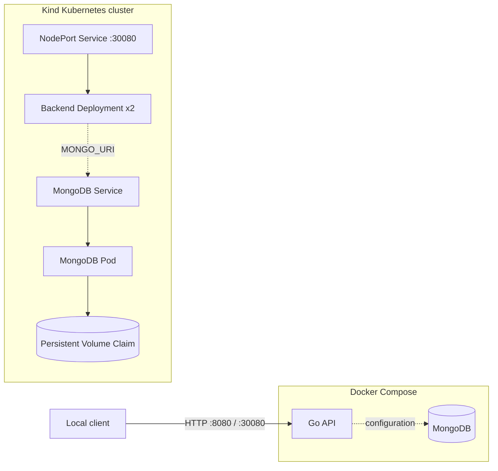

# MuchTodo API — Docker and Kubernetes Deployment Lab

A hands-on DevOps portfolio project for packaging a small Go HTTP service, running it with MongoDB through Docker Compose, and deploying it to a local Kubernetes cluster using Kind.

The Go API connects to MongoDB and provides CRUD endpoints for todo items. This is a learning/portfolio lab, not a live production service.

## Architecture



## Technology

- Go HTTP service with MongoDB-backed todo CRUD endpoints and database readiness checks
- Multi-stage Docker build with a minimal distroless, non-root runtime
- Docker Compose for local multi-container development
- MongoDB 6 with persistent storage
- Kubernetes Deployments, Services, ConfigMaps, Secrets, PVC, health probes and resource requests/limits
- Kind for a local Kubernetes cluster
- Bash scripts for repeatable build, deploy and cleanup

## Repository layout

```text
.
├── application-code/       # Go application source and module files
├── kubernetes/             # Namespace, backend and MongoDB manifests
├── scripts/                # Docker and Kind helper scripts
├── Dockerfile              # Multi-stage Go image build
├── docker-compose.yml      # Local development stack
├── .env.example            # Compose variable template (no real secrets)
├── .env.k8s.*.example      # Kubernetes secret input templates
└── README.md
```

## Prerequisites

- Docker Engine with Docker Compose v2
- Go 1.22+ (for local tests)
- Kind
- kubectl
- Bash

## 1. Run with Docker Compose

Create a local environment file:

```bash
cp .env.example .env
```

Edit `.env` and replace all placeholder values. Use a strong password containing only URL-safe alphanumeric characters for this local example, or URL-encode special characters when constructing the MongoDB URI.

Build and start:

```bash
./scripts/docker-build.sh
./scripts/docker-run.sh
```

Verify the API:

```bash
curl --fail http://localhost:8080/health
curl --fail http://localhost:8080/ready
docker compose ps
docker compose logs backend
```

Expected health response:

```json
{"status":"healthy","service":"muchtodo-api"}
```

Stop the stack:

```bash
docker compose down
```

To also delete the local MongoDB volume and all stored lab data:

```bash
docker compose down --volumes
```

## 2. Deploy to Kubernetes with Kind

Create local Kubernetes secret input files:

```bash
cp .env.k8s.mongodb.example .env.k8s.mongodb
cp .env.k8s.backend.example .env.k8s.backend
```

Set the MongoDB root username/password in `.env.k8s.mongodb`. Set `MONGO_URI` in `.env.k8s.backend` to match those credentials and the in-cluster service name `mongodb`.

These files are ignored by Git. Never commit populated secret files, Kubernetes Secret manifests containing real values, kubeconfig files, or screenshots with credentials.

Build and deploy:

```bash
./scripts/k8s-deploy.sh
```

The script creates the Kind cluster if needed, builds and loads the local image, applies the namespace and configuration, creates Kubernetes Secrets from local env files, and waits for both Deployments to become ready.

Verify:

```bash
kubectl get pods,services,pvc -n muchtodo
kubectl rollout status deployment/backend -n muchtodo
curl --fail http://localhost:30080/health
curl --fail http://localhost:30080/ready
```

Inspect logs and events:

```bash
kubectl logs deployment/backend -n muchtodo
kubectl describe pods -n muchtodo
kubectl get events -n muchtodo --sort-by=.lastTimestamp
```

Cleanup (the script asks for confirmation):

```bash
./scripts/k8s-cleanup.sh
```

## API reference

All endpoints return JSON except successful `DELETE`, which returns HTTP 204.

| Method | Endpoint | Purpose |
|---|---|---|
| GET | `/health` | Process liveness; does not require MongoDB |
| GET | `/ready` | Checks MongoDB connectivity |
| GET | `/todos` | List todo items |
| POST | `/todos` | Create a todo: `{\"title\":\"Learn Go\",\"description\":\"Build an API\"}` |
| GET | `/todos/{id}` | Retrieve a todo by MongoDB ObjectID |
| PUT | `/todos/{id}` | Replace editable todo fields |
| DELETE | `/todos/{id}` | Delete a todo |

Titles are required and limited to 200 characters; descriptions are limited to 2,000 characters. Unknown JSON fields and malformed IDs are rejected.

Example create request:

```bash
curl -X POST http://localhost:8080/todos \\
  -H 'Content-Type: application/json' \\
  -d '{"title":"Learn Go","description":"Build a MongoDB-backed API"}'
```

## 3. Run Go tests locally

```bash
cd application-code
go test ./...
```

## Security controls demonstrated

- Multi-stage build separates compiler/toolchain from runtime.
- Runtime image runs as a non-root user.
- Backend container drops Linux capabilities, disallows privilege escalation and uses a read-only root filesystem.
- MongoDB credentials are injected at deployment time from ignored local env files, not committed in Kubernetes manifests.
- Kubernetes startup, readiness and liveness probes are configured.
- CPU/memory requests and limits are defined.
- Docker Compose publishes the API only on the local loopback interface.
- MongoDB is not published to the host.
- Cleanup is explicit and warns before deleting the Kind cluster.

For real shared/production environments, use a managed secret store, Kubernetes encryption at rest, network policies, image scanning, pinned image digests, TLS, and an externally managed backup/restore strategy.

## Current limitations and next improvements

- MongoDB currently uses the root account for this isolated local learning environment. Use a dedicated least-privilege application user and managed secrets before any shared or production deployment.
- MongoDB runs as a single pod for this local lab; this is not a highly available database topology.
- The optional Ingress manifest requires an Ingress controller and local DNS/hosts configuration; the default Kind path uses NodePort.
- This project does not yet include Prometheus/Grafana monitoring or Docker Swarm/Traefik. Those will be separate portfolio labs so the technologies are demonstrated accurately.

## Troubleshooting

**Backend image not found in Kind**

```bash
docker images | grep muchtodo-api
kind load docker-image muchtodo-api:local --name muchtodo
kubectl rollout restart deployment/backend -n muchtodo
```

**Backend pods are not ready**

```bash
kubectl describe pod -n muchtodo -l app=backend
kubectl logs -n muchtodo deployment/backend
```

**MongoDB is not ready**

```bash
kubectl describe pod -n muchtodo -l app=mongodb
kubectl logs -n muchtodo deployment/mongodb
```

Check that the local MongoDB secret values match the backend `MONGO_URI`.
